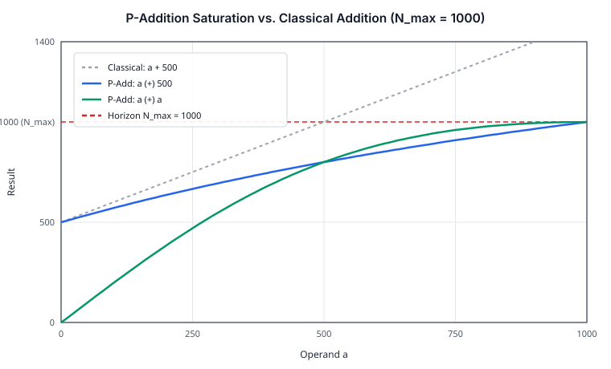
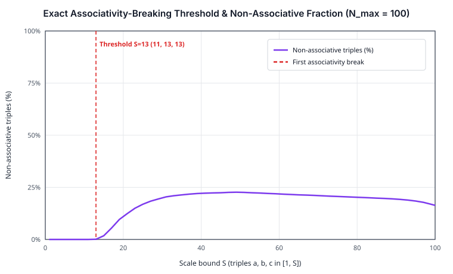
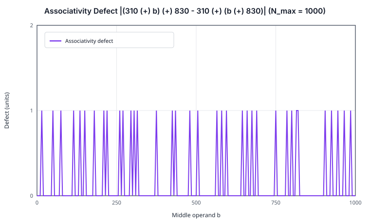
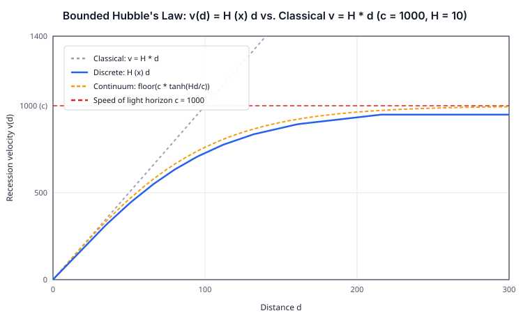
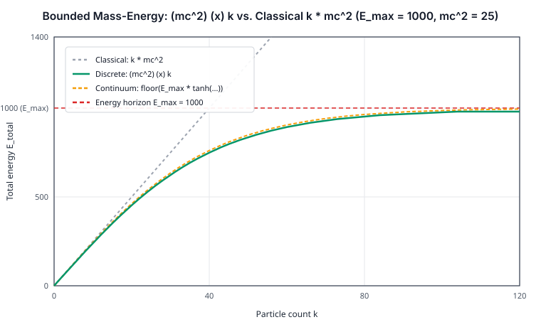

# $\mathcal{P}$-Arithmetic

[](https://doi.org/10.5281/zenodo.24543223)
[](https://doi.org/10.5281/zenodo.24538223)
[](https://orcid.org/0009-0001-4099-2572)
[](https://github.com/lastriv/P-Arithmetic/actions/workflows/ci.yml)
[](https://www.python.org/downloads/)
[](https://creativecommons.org/licenses/by/4.0/)

**Physically Bounded Non-Associative Arithmetic ($\mathcal{P}$-Arithmetic): Replacing Actual Infinity with Relativistic and Planckian Constraints.**

This repository provides the zero-dependency Python reference library (`p_add`, `p_mul`), formal machine-readable specification ([`SPEC.md`](SPEC.md)), unit tests, and generated visualizations accompanying the paper:

> [Ilya Radkevich](https://orcid.org/0009-0001-4099-2572), *Physically Bounded Non-Associative Arithmetic ($\mathcal{P}$-Arithmetic): Replacing Actual Infinity with Relativistic and Planckian Constraints* (November 2026).

---

## Core Idea

Instead of assuming the Axiom of Infinity, $\mathcal{P}$-Arithmetic operates over a finite discrete set $\mathbb{P} = \{0, 1, 2, \dots, N_{\max}\}$ with relativistic-style bounded addition:

$$a \oplus b = \left\lfloor \frac{a + b}{1 + \frac{a \cdot b}{N_{\max}^2}} \right\rfloor, \qquad a \otimes b = \underbrace{a \oplus a \oplus \dots \oplus a}_{b \text{ times}}$$

- **At everyday scales ($a, b \ll N_{\max}$):** Standard arithmetic is recovered within 1-unit floor quantization ($a \oplus b = a + b - 1$ for $a, b \ge 1$, relative error $\to 0$).
- **Near the horizon ($N_{\max}$):** Floor quantization breaks associativity and cancellation, $S(n) = n \oplus 1$ saturates ($S(n) = n$ for all $n \ge 1$ under strict floor), and repeated addition converges to $\tanh$.

See [`SPEC.md`](SPEC.md) for the complete formal specification, invariants, and conformance test vectors for developers and AI agents.

---

## Quickstart

```bash
git clone https://github.com/lastriv/P-Arithmetic.git
cd P-Arithmetic
```

```python
from p_arithmetic import p_add, p_mul, associativity_defect, saturation_threshold

n_max = 100

# Everyday scale (within 1-unit floor quantization)
assert p_add(3, 4, n_max=10_000) == 6
assert p_mul(3, 4, n_max=10_000) == 9

# Horizon impenetrability & floor quantum saturation (S(n) = n for n >= 1)
assert p_add(n_max, 42, n_max) == n_max
assert saturation_threshold(100) == 1  # 1 (+) 1 == 1 under strict floor

# Exact arbitrary-precision integer arithmetic even at cosmological scales
assert p_add(10**120, 10**120, n_max=10**120) == 10**120
```

Run tests and regenerate plots:

```bash
python -m unittest discover -s tests -v
python scripts/generate_plots.py
```

---

## Visualizations

### Saturation vs. Classical Addition


### Non-Associativity & Associativity-Breaking Threshold



### Computational Experiment Summary (`scripts/generate_plots.py`)

| Toy Universe ($N_{\max}$) | First Associativity Break $(a, b, c)$ | Scale Threshold $S_{\text{break}}$ | Max Non-Associative Fraction |
| :---: | :---: | :---: | :---: |
| $100$ | $(11, 13, 13)$ | $13$ | $22.66\%$ |
| $1000$ | $(54, 56, 56)$ | $56$ | — |

*(Note: Symmetric triples $(a, a, a)$ never break associativity because $\oplus$ is commutative: $(a \oplus a) \oplus a = a \oplus (a \oplus a)$.)*

### Cosmological Toy Models
| Bounded Hubble's Law | Bounded Mass-Energy Equivalence |
| :---: | :---: |
|  |  |

---

## Repository Structure

```text
P-Arithmetic/
├── p_arithmetic.py       # Single-file zero-dependency implementation (core + cosmology)
├── SPEC.md               # Formal specification & test vectors for devs and AI agents
├── README.md             # Overview, plots, and Zenodo DOI / ORCID / CI badges
├── CITATION.cff          # GitHub & Zenodo citation metadata
├── LICENSE               # CC BY 4.0 license
├── lean/
│   ├── PArithmetic.lean  # Pure Lean 4 formalization of axioms and algebraic theorems
│   ├── lakefile.lean
│   └── lean-toolchain
├── scripts/
│   └── generate_plots.py # Zero-dependency SVG plot generator
├── plots/                # Generated SVG figures
├── tests/
│   ├── test_p_arithmetic.py
│   └── test_vectors.json # Machine-readable conformance vectors
├── .github/workflows/
│   └── ci.yml            # Python (3.10-3.13) & Lean 4 CI
└── pyproject.toml
```

---

## Citation

If you use this work, please cite the paper (`10.5281/zenodo.24538223`) and software release (`10.5281/zenodo.24543223`):

```bibtex
@misc{radkevich2026parithmetic,
  author       = {Radkevich, Ilya},
  title        = {Physically Bounded Non-Associative Arithmetic ($\mathcal{P}$-Arithmetic): Replacing Actual Infinity with Relativistic and Planckian Constraints},
  year         = {2026},
  month        = nov,
  doi          = {10.5281/zenodo.24538223},
  url          = {https://github.com/lastriv/P-Arithmetic}
}

@software{radkevich2026parithmetic_code,
  author       = {Radkevich, Ilya},
  title        = {P-Arithmetic: Python Library, Specification, Plots, and Lean 4 Formalization},
  year         = {2026},
  month        = nov,
  version      = {v0.1.0},
  doi          = {10.5281/zenodo.24543223},
  url          = {https://github.com/lastriv/P-Arithmetic}
}
```
